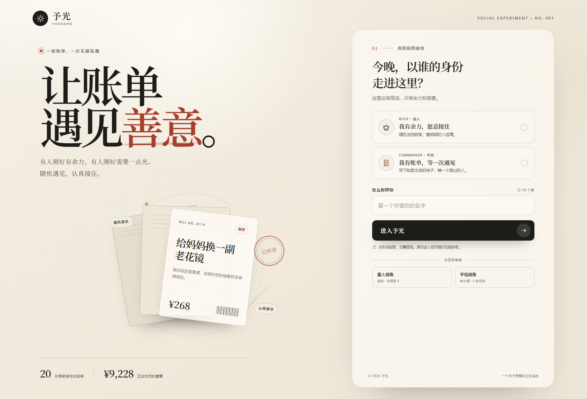
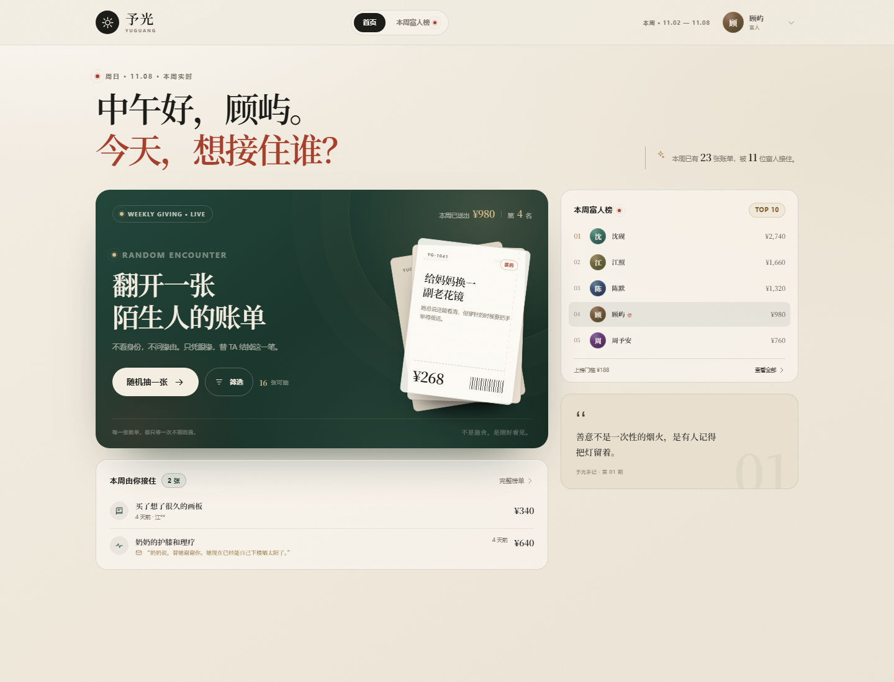
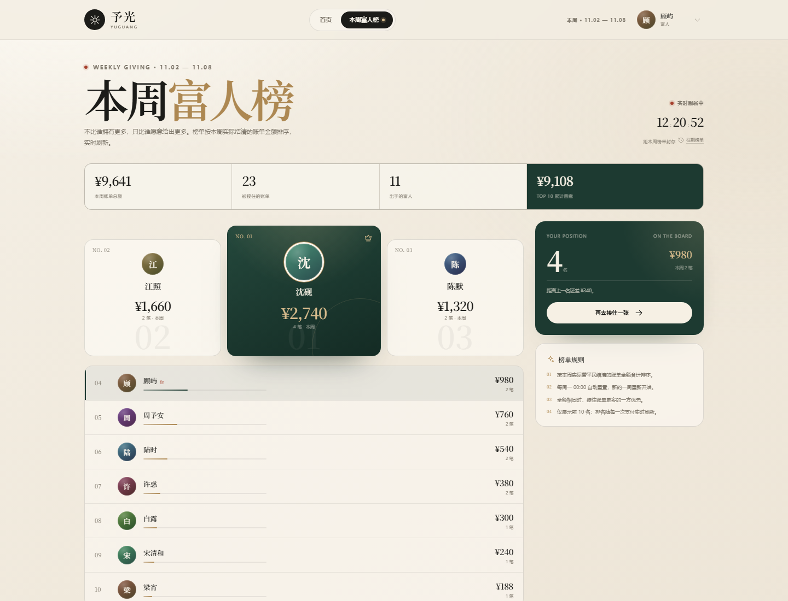
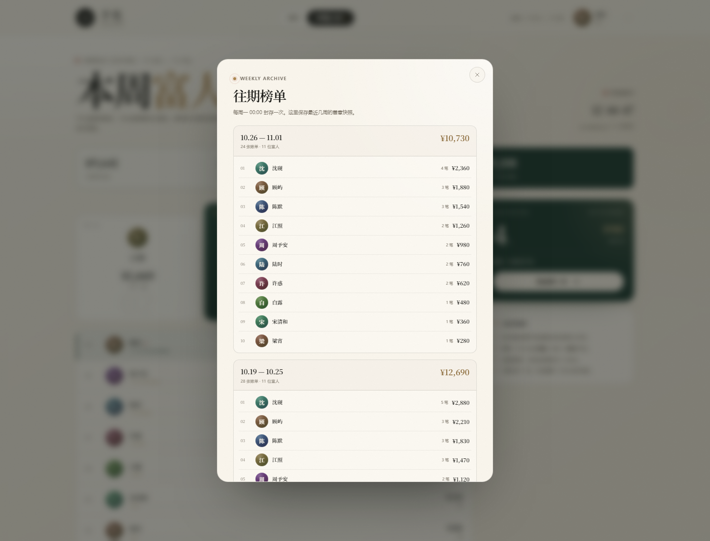
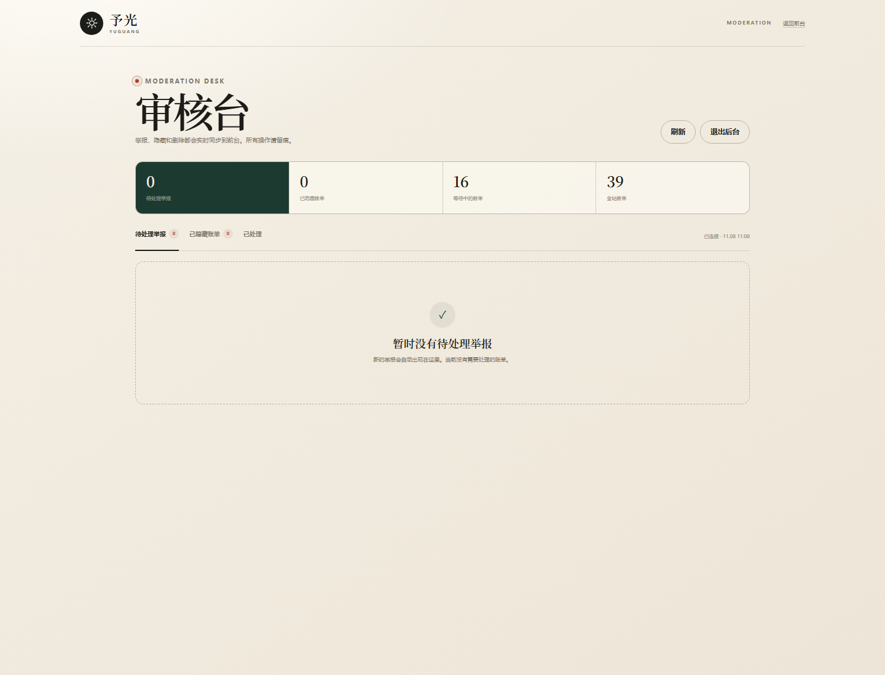

# 予光 YUGUANG

> 让账单，遇见善意。

一个可以直接跑起来的产品原型：用户登录后选择「富人」或「平民」身份。平民发布账单，富人随机翻开陌生人的账单并替 TA 结清；每周一 00:00 重置的「本周富人榜」按实际支付金额排出前十名，并通过 SSE 实时刷新。



## 已实现

- **身份登录**：昵称 + 富人 / 平民身份选择；一个账号进入后固定身份，可随时切换账号。
- **平民发布账单**：分类、金额、标题、说明；最多同时保留 3 张待结清账单；可撤回。
- **富人随机抽单**：随机翻阅待结清账单，支持换一张、查看故事、写一句话、模拟支付。
- **筛选抽单**：富人可按分类、金额区间、城市缩小随机范围，并保留筛选状态。
- **真实并发保护**：同一张账单被其他人先支付时返回冲突提示，不会重复结清。
- **双向回信**：平民结清后可写一封「谢谢」，富人会在首页的支付记录里看到这封回信。
- **每周富人榜**：按本周已结清金额排序，展示前 10 名；金额相同时按接住笔数排序。
- **往期榜单**：每周一自动封存快照，支持查看最近几周的历史前十。
- **匿名发布**：发布时可选择只显示「匿名平民」，不展示昵称首字。
- **举报与审核**：富人可举报待结清账单；同一张账单收到 3 条待处理举报后自动进入审核，`/admin` 提供基础审核台，可隐藏 / 恢复 / 删除账单。
- **实时刷新**：Node 服务通过 SSE 推送数据变更，多个浏览器窗口之间的排行榜、账单状态会同步更新。
- **演示数据**：自动生成 12 位富人、15 位平民、38 张账单，以及本周 20 笔已结清记录。
- **移动端适配**：390 / 360 px 手机视口与桌面端均已适配；包含 PWA manifest。
- **本地持久化**：数据写入 `data/db.json`，重启服务不丢失。








## 启动

需要 Node.js 20+。本项目零第三方依赖。

```powershell
# 方式一：Windows 双击
.\start.cmd

# 方式二：PowerShell
.\start.ps1

# 方式三：已有 node 命令
node server.js
```

打开 **http://127.0.0.1:4173**。

首次启动会自动创建 `data/db.json` 并生成本周演示数据。在「我的 → 重置演示数据」可以恢复初始状态。

如果要把服务放到公网给朋友体验，建议用公开模式启动：

```powershell
$env:PUBLIC_MODE = '1'
node server.js
```

公开模式会关闭「重置演示数据」接口，避免访问者清空数据；登录、发布和支付仍然是模拟的，所有内容公开可见，请勿填写真实姓名、电话或住址。

### 免费部署到 Render

仓库里已经准备好：

- `Dockerfile`：Node 22 + 非 root 用户 + `HOST=0.0.0.0`
- `render.yaml`：免费 Docker Web Service，自动设置 `PUBLIC_MODE=1` 并生成 `ADMIN_TOKEN`
- `.dockerignore`：不会把 `data/`、审核口令、开发截图打进镜像

步骤：

1. 在 GitHub 新建一个空仓库（不要上传 `data/`）。
2. 把项目文件上传到仓库；或者解压 `yuguang-render.zip` 后上传里面的内容。
3. 打开 [Render](https://render.com)，用 GitHub 登录，选择 **New → Blueprint**，连接这个仓库。
4. Render 读取 `render.yaml` 后点 **Apply**。
5. 部署完成后会得到一个固定地址，例如 `https://yuguang.onrender.com`。

免费版的限制要说清楚：

- 一段时间没人访问会休眠，第一次打开可能要等几十秒。
- 免费实例的磁盘是临时的，**重新部署或重启后数据会恢复为初始演示数据**。
- `onrender.com` 在国内和微信里可能访问不稳定，必要时需要绑自己的域名。
- 如果 `ADMIN_TOKEN` 是自动生成的，到 Render 的 **Environment** 页面查看；审核后台地址是 `https://你的地址/admin`。

如果之后要保留真实用户数据，再给 Render 挂持久磁盘（付费），或者把存储迁移到 Postgres。当前阶段先把“固定网址 + 可访问”跑通。

本地也可以验证 Docker 镜像：

```powershell
docker build -t yuguang .
docker run --rm -p 4173:10000 -e PUBLIC_MODE=1 -e ADMIN_TOKEN=test-token yuguang
```

### 审核后台

启动时会自动生成 `ADMIN_TOKEN` 并保存在 `data/admin-token.txt`（已加入 `.gitignore`），控制台也会打印口令。

- 地址：`http://127.0.0.1:4173/admin`
- 也可以用环境变量覆盖：`$env:ADMIN_TOKEN = 'your-token'`
- 后台可以查看待处理举报、隐藏/恢复账单、永久删除账单。
- 前台右上角没有后台入口，避免普通访问者误入。



### 演示账号

登录页底部提供两个一键体验入口：

| 视角 | 账号 | 初始状态 |
| --- | --- | --- |
| 富人 | 顾屿 | 本周已送出 ¥980，排名第 4 |
| 平民 | 林小满 | 2 张待结清，1 张已被接住 |

也可以直接访问：

- 富人首页：`http://127.0.0.1:4173/?demo=rich`
- 平民首页：`http://127.0.0.1:4173/?demo=commoner`
- 富人榜：`http://127.0.0.1:4173/?demo=rich&view=leaderboard`

### 手机访问

默认只监听本机。若要在同一局域网的手机上访问：

```powershell
$env:HOST = '0.0.0.0'
$env:PORT = '4173'
node server.js
```

然后用电脑的局域网 IP 访问，例如 `http://192.168.1.10:4173`。仅建议在可信局域网内使用；这不是生产级鉴权。

## 体验路径

**富人视角**

1. 在首页点击「筛选」，按分类 / 金额 / 城市缩小范围；也可以直接随机抽一张。
2. 可以「换一张」，或点击「替 TA 付掉」。
3. 写一句留言，确认模拟支付。
4. 成功页会显示本周累计金额和排名变化；榜单与其他窗口会实时更新。
5. 在账单弹窗底部可以举报不当内容；举报达到 3 条会自动进入审核。

**平民视角**

1. 点击「发布一张账单」。
2. 选择分类、填写金额、城市、标题和说明；可以选择匿名发布。
3. 发布后可在「等待中 / 已结清」之间切换查看。
4. 当富人结清后，账单会盖上「已结清」印章，并显示付款人昵称首字与留言。
5. 点击「写一句谢谢」，回信会出现在富人的首页支付记录里。

## 排名规则

- 仅统计本周一 00:00 至下周一 00:00 之间实际结清的账单金额。
- 金额相同，接住账单更多的一方优先。
- 仅展示前 10 名；每次支付后实时刷新。
- 每周一 00:00 自动重置。为让演示数据持续可用，**示例富人的种子记录**会在新的一周自动平移到当前周；真实用户自己的历史支付不会跨周重复计入。

## 技术结构

```text
server.js              零依赖 Node HTTP 服务：静态文件、JSON API、Cookie Session、SSE
public/index.html      应用骨架与 SVG 图标库
public/styles.css      视觉系统与响应式布局
public/app.js          单页应用：状态、路由、弹窗、表单、实时刷新
public/admin.html      独立审核后台
public/admin.js        审核后台逻辑
public/admin.css       审核后台样式
public/manifest.webmanifest
data/db.json           运行时生成的数据（已加入 .gitignore）
data/admin-token.txt   自动生成的审核口令（已加入 .gitignore）
shots/                 开发期截图脚本与临时产物（已加入 .gitignore）
screenshots/           README 使用的成品截图
```

### API 速览

| 方法 | 路径 | 说明 |
| --- | --- | --- |
| `GET` | `/api/public` | 本周公开统计（登录页用） |
| `POST` | `/api/login` | 昵称 + 身份登录 |
| `POST` | `/api/login/demo` | 一键演示登录 |
| `GET` | `/api/state` | 当前用户、账单、榜单聚合数据 |
| `POST` | `/api/bills` | 平民发布账单（分类 / 金额 / 城市 / 匿名） |
| `DELETE` | `/api/bills/:id` | 平民撤回待结清账单 |
| `POST` | `/api/bills/:id/pay` | 富人模拟支付 |
| `POST` | `/api/bills/:id/thanks` | 平民写回信 |
| `POST` | `/api/bills/:id/report` | 举报待结清账单 |
| `GET` | `/api/admin/state` | 审核台数据（需要 `X-Admin-Token`） |
| `POST` | `/api/admin/reports/:id` | 隐藏 / 忽略举报 |
| `POST` | `/api/admin/bills/:id/visibility` | 恢复 / 隐藏账单 |
| `DELETE` | `/api/admin/bills/:id` | 永久删除账单 |
| `POST` | `/api/logout` | 退出 |
| `GET` | `/api/events` | SSE 实时事件流 |

## 这是一个原型，不是生产系统

当前版本刻意把「完成核心体验」放在第一位：

- **登录**：没有密码、短信或第三方 OAuth；昵称 + 身份即可进入，仅适合本机演示。
- **支付**：完全是模拟记录，没有调用微信 / 支付宝，不会产生真实扣款。
- **数据**：JSON 文件单机持久化，没有数据库、并发事务、备份和审计。
- **实时**：SSE 是单进程内存广播，多实例部署需要 Redis Pub/Sub 或消息队列。
- **风控**：有基础敏感词过滤、举报和审核后台，但没有实名认证、反欺诈、额度限制与申诉机制。

若要走真实业务，至少还需要：手机号 / 微信登录、支付通道与异步回调幂等、账单真实性审核、第三方凭证与隐私打码、隐私与数据合规、反洗钱与支付合规评估、内容审核、限额与异常交易风控，以及独立的对账与客服流程。涉及真实资金代付时，建议先咨询支付与法律合规顾问。

### 下一阶段

- 账单凭证上传与手动隐私打码
- Postgres + Redis，替换单文件 JSON 与单进程 SSE
- 微信支付 v3 回调、幂等、对账与退款
- 第三方实名 / 企业认证
- 更细的审核后台：用户维度、操作日志、申诉

## 下一步可以做什么

- 富人端按分类 / 金额 / 城市筛选，而不只靠随机。
- 平民端增加账单凭证上传与隐私打码。
- 支付后的「谢谢」回信，形成双向故事。
- 每周榜单快照与历史榜单。
- 实名 / 匿名模式、举报与内容审核后台。
- 把 SSE + JSON 存储替换成 Postgres + Redis，接真实支付回调。
